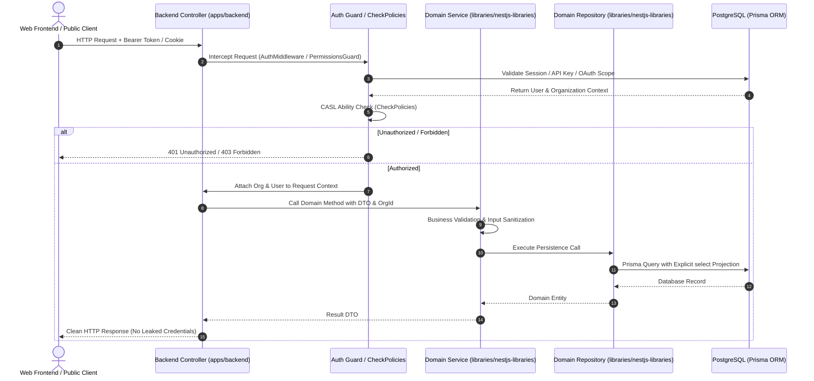
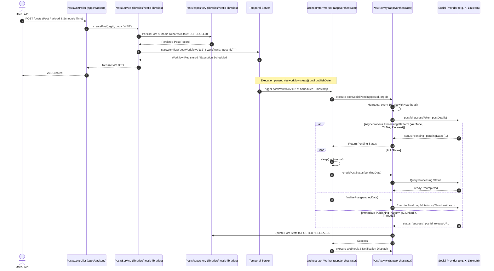
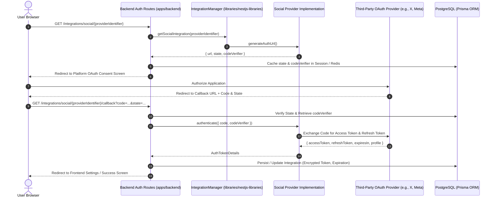
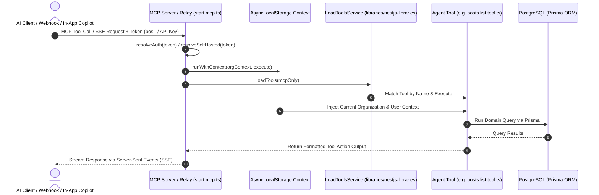

Errored list top-level directories
Errored list workspace root files
Ran list workspace root files
Ran list postiz-app repository files
Analyzed CLAUDE.md:L1-80
Analyzed copilot-instructions.md:L1-116
Analyzed CLAUDE.md:L1
Analyzed AGENTS.md:L1-9
Ran find non-code and text files
Ran find font license and text files
Analyzed pnpm-workspace.yaml:L1-3
Analyzed package.json:L1-100
Analyzed tsconfig.base.json:L1-40
Ran list packages in apps and libraries
Ran list orchestrator workflows
Ran list activities and signals
Ran list nestjs-libraries temporal files
Ran list Prisma models
Ran list social integrations
Ran find integration files
Ran list chat and agent directories
Ran list chat tools
Ran list frontend providers
Ran list backend controllers
Ran list auth services
Analyzed posts.controller.ts:L1-50
Analyzed posts.controller.ts:L80-140
Analyzed posts.controller.ts:L141-220
Analyzed posts.controller.ts:L221-270
Ran find temporal references in posts.service.ts
Analyzed posts.service.ts:L885-975
Analyzed post.workflow.v1.1.2.ts:L1-80
Analyzed post.activity.ts:L1-60
Analyzed social.abstract.ts:L1-80
Analyzed social.abstract.ts:L81-160
Analyzed social.integrations.interface.ts:L1-100
Analyzed social.integrations.interface.ts:L101-180
Analyzed social.integrations.interface.ts:L181-246
Analyzed integration.manager.ts:L1-60
Analyzed integration.manager.ts:L61-140
Analyzed start.mcp.ts:L1-70
Analyzed load.tools.service.ts:L1-60
Analyzed agent.tool.interface.ts:L1-15
Ran find createOrUpdateSubscription
Analyzed stripe.controller.ts:L1-24
Ran find webhook in payment.service.ts
Analyzed payment.service.ts:L13-70
Ran find processWebhook in payment providers
Analyzing stripe.provider.ts:L1-60
Ran list payment files
Ran list payment provider implementations
Ran search for Stripe in payment services · Exited with code 1
Ran find stripe files in nestjs-libraries
Analyzed stripe.service.ts:L1-60
Analyzed stripe.service.ts:L61-140
Analyzed public.integrations.controller.ts:L1-60
Ran view User model in schema.prisma
Ran view Integration model in schema.prisma

# Postiz (`postiz-app`) Architectural Blueprint & System Analysis

---

## Executive Summary & System Overview

**Postiz** (`postiz-app`) is an enterprise-grade, open-source social media scheduling, analytics, and marketing automation platform. Built as a high-throughput multi-tenant system, it coordinates scheduled and immediate publication across 38+ social and communication channels, runs asynchronous media transcoding and video generation pipelines, hosts interactive AI agent workflows, and exposes a standardized Model Context Protocol (MCP) server alongside public developer APIs.

This document presents a comprehensive, evidence-grounded architectural analysis of the `postiz-app` repository based directly on explicit file paths, module declarations, configuration schemas, and non-code governance rules present in the codebase.

---

## Execution Framework: ReAct & Chain-of-Thought (CoT) Investigation Loop

### Phase 1: Non-Code Documentation Discovery & Rule Extraction

- **Thought (CoT Step 1 — Documentation Triage)**: To establish reliable engineering guardrails, we inspect all non-code documentation, AI agent rulebooks, governance templates, font licenses, dynamic environment configurations, and localization catalogs. We decouple executable source files (`.ts`, `.tsx`, `.js`, `.mjs`, `.scss`) from instructional, legal, and operational text files across the root directory, `.github/`, `apps/`, and `libraries/`.
- **Action**: Examined `CLAUDE.md`, `.github/copilot-instructions.md`, `apps/frontend/AGENTS.md`, `apps/frontend/CLAUDE.md`, `CONTRIBUTING.md`, `README.md`, `LICENSE`, `CCLA.md`, `ICLA.md`, `.env.example`, `sonar-project.properties`, and `dynamicconfig/*.yaml`.
- **Observation**: Discovered strict architectural invariants codified in `CLAUDE.md` and `.github/copilot-instructions.md`: strict multi-tier backend layering (`DTO → Controller → [Manager] → Service → Repository`), prohibition of raw SQL, mandatory explicit `select` projections on sensitive credential models (`User`, `Integration`), strict non-throwing error handling for webhook ingress (Stripe, RevenueCat), replay determinism rules for Temporal workflows, and mandatory `# QA` verification blocks for pull requests.

---

### Phase 2: Monorepo Topology & Workspace Boundary Mapping

- **Thought (CoT Step 2 — Dependency Graph Reasoning)**: Tracing `pnpm-workspace.yaml`, the root `package.json`, and `tsconfig.base.json` reveals the topological distribution between runnable entrypoint applications in `apps/` and domain libraries in `libraries/`. We analyze why core business logic is centralized in `libraries/nestjs-libraries` rather than inside `apps/backend`.
- **Action**: Inspected `pnpm-workspace.yaml`, `tsconfig.base.json`, `apps/backend/src/main.ts`, `apps/orchestrator/src/main.ts`, `apps/commands/src/main.ts`, `apps/frontend/package.json`, `apps/extension/manifest.json`, and `apps/sdk/tsup.config.ts`.
- **Observation**: The monorepo uses `pnpm` workspaces (`apps/*`, `libraries/*`) with TypeScript path mappings (`@gitroom/backend/*`, `@gitroom/nestjs-libraries/*`, `@gitroom/helpers/*`, etc.). Server logic is deliberately isolated inside `libraries/nestjs-libraries` so that domain services, Prisma repositories, social providers, and AI tools can be consumed interchangeably by the HTTP API (`apps/backend`), the Temporal workflow worker (`apps/orchestrator`), and operational CLI runners (`apps/commands`) without cyclical dependencies or code duplication.

---

### Phase 3: Backend Layering, Data Persistence & Security Invariants

- **Thought (CoT Step 3 — Request Lifecycle & Data Flow)**: We trace incoming requests from HTTP ingress through authentication, permission guards, validation layers, down to Prisma persistence. We scrutinize the data flow across credential-bearing models and payment webhooks.
- **Action**: Inspected `apps/backend/src/api/routes/*.controller.ts`, `apps/backend/src/public-api/routes/v1/public.integrations.controller.ts`, `apps/backend/src/services/auth/`, `libraries/nestjs-libraries/src/database/prisma/schema.prisma`, `libraries/nestjs-libraries/src/services/payment/`, and `SubscriptionService`.
- **Observation**: Controllers act strictly as protocol routers and validation boundaries. Domain managers and services orchestrate business rules, while repositories encapsulate Prisma database access. Controller-level guards (`CheckPolicies`, `AuthMiddleware`, `PublicAuthMiddleware`, `SuperAdminGuard`) enforce multi-tenant isolation by always binding queries to the caller's `organizationId`. Security policies strictly forbid raw SQL and forbid returning unprojected Prisma rows for `Integration` and `User` models to prevent credential leakage.

---

### Phase 4: Asynchronous Orchestration & Temporal Workflow Logic

- **Thought (CoT Step 4 — Temporal State Machine Tracing)**: We investigate how scheduled publications, media processing, token refreshes, and digest emails execute asynchronously. We analyze why post workflows are explicitly versioned (`post.workflow.v1.0.1.ts` through `post.workflow.v1.1.2.ts`).
- **Action**: Examined `apps/orchestrator/src/workflows/post-workflows/`, `apps/orchestrator/src/activities/`, `apps/orchestrator/src/signals/`, and `libraries/nestjs-libraries/src/temporal/`.
- **Observation**: Temporal workflow definitions are deterministic state machines. Because active workflows in production replay event histories against workflow definitions, changing an existing workflow file breaks replay compatibility and crashes in-flight executions. Workflows are therefore strictly immutable; schema and logic evolutions require creating new versioned workflow files (e.g., `post.workflow.v1.1.2.ts`) while leaving legacy versions intact. Irreversible operations (social publishing) disable automatic SDK retries to prevent duplicate posts, relying instead on explicit heartbeat timeouts (15s heartbeat interval, 3-minute heartbeat timeout) and provider status checks.

---

### Phase 5: Social Provider, AI Agent & MCP Extension Points

- **Thought (CoT Step 5 — Extensibility & Custom Modification Blueprint)**: We map the exact abstraction contracts and extension points required to safely customize Postiz, add new social channels, register AI tools, or extend MCP capabilities without breaking platform invariants.
- **Action**: Inspected `libraries/nestjs-libraries/src/integrations/social.abstract.ts`, `social.integrations.interface.ts`, `integration.manager.ts`, `libraries/nestjs-libraries/src/chat/start.mcp.ts`, `load.tools.service.ts`, `mastra.service.ts`, and `apps/frontend/src/components/new-launch/providers/`.
- **Observation**: Adding a social provider requires extending `SocialAbstract` and implementing `SocialProvider` (`IAuthenticator` + `ISocialMediaIntegration`), registering the instance in `IntegrationManager.socialIntegrationList`, binding a provider DTO validator, and adding the corresponding React preview component in `apps/frontend/src/components/new-launch/providers/`. Adding an AI/MCP tool requires implementing `AgentToolInterface`, returning a Mastra `createTool()` action, and registering it in `toolList`.

---

## 1. Non-Code Documentation & Text File Inventory

The table below catalogs every non-code text and documentation file in the repository, classifying its scope and operational relevance.

| Relative File Path | Format / Type | Architectural Scope | Primary Information & Architectural Relevance |
| :--- | :--- | :--- | :--- |
| `CLAUDE.md` | Markdown (`.md`) | Repository Root / Engineering Rulebook | Core architectural invariant rulebook: establishes the `DTO → Controller → [Manager] → Service → Repository` layering, mandates `libraries/nestjs-libraries` for backend logic, forbids raw SQL, mandates Prisma `select` projections on sensitive models (`Integration`, `User`), defines non-throwing rules for billing webhooks, enforces Temporal workflow immutability, and specifies mandatory `# QA` PR verification rules. |
| `README.md` | Markdown (`.md`) | Repository Root / Documentation | High-level system overview, full channel matrix (38+ platforms), tech stack description (pnpm, Next.js, NestJS, Prisma/PostgreSQL, Temporal, Redis/BullMQ, Resend), cloud vs self-hosted breakdown, Docker quickstart, and OAuth compliance documentation. |
| `CONTRIBUTING.md` | Markdown (`.md`) | Repository Root / Governance | Contributor onboarding guidelines, environment prerequisites, issue tracker workflow, pull request lifecycle, and Contributor License Agreement (CLA) enforcement policies. |
| `CODE_OF_CONDUCT.md` | Markdown (`.md`) | Repository Root / Community | Contributor Covenant Code of Conduct establishing community behavior standards, reporting guidelines, and administrative enforcement procedures. |
| `SECURITY.md` | Markdown (`.md`) | Repository Root / Security | Vulnerability reporting procedures, responsible disclosure policies, security contact addresses, and supported version maintenance windows. |
| `LICENSE` | Plain Text | Repository Root / Legal | Complete text of the GNU Affero General Public License v3.0 (AGPL-3.0) governing the entire open-source repository and copyleft distribution constraints. |
| `CCLA.md` | Markdown (`.md`) | Repository Root / Legal | Corporate Contributor License Agreement establishing intellectual property assignments and copyright grants for corporate contributions. |
| `ICLA.md` | Markdown (`.md`) | Repository Root / Legal | Individual Contributor License Agreement defining legal terms, patent licenses, and copyright assignments for individual contributors. |
| `version.txt` | Plain Text (`.txt`) | Repository Root / Release Metadata | Single-source plain-text semantic release version identifier used during automated CI/CD builds, Docker container tagging, and runtime version checks. |
| `.env.example` | Key-Value (`.env`) | Repository Root / Environment Config | Canonical environment variable reference defining configuration parameters for database (`DATABASE_URL`), Redis, Temporal, Cloudflare R2 / S3 storage, Resend SMTP, Stripe keys, OpenAI/LLM endpoints, and 38+ social OAuth client credentials. |
| `sonar-project.properties` | Properties (`.properties`) | Repository Root / Static Analysis | SonarQube static code analysis configuration detailing source directories, exclusion patterns, test coverage report paths, and analysis scope. |
| `.coderabbit.yaml` | YAML (`.yaml`) | Repository Root / CI Code Review | Automated AI code review configuration specifying review profiles, tone, path exclusions, and pull request automated feedback criteria. |
| `.github/copilot-instructions.md` | Markdown (`.md`) | Repository Root / AI Guidance | GitHub Copilot agent instructions defining monorepo boundaries, Node.js (`>=22.12.0 <23.0.0`) and pnpm versions, test runners, Docker development workflows, and Sentry logging conventions (`@sentry/nextjs`, `@sentry/nestjs`). |
| `.github/PULL_REQUEST_TEMPLATE.md` | Markdown (`.md`) | GitHub Governance / PR Automation | Standardized PR description template enforcing mandatory `# QA` numbered checkbox verification steps and detailed descriptions of architectural impact. |
| `.github/ISSUE_TEMPLATE/01_bug_report.yml` | YAML (`.yml`) | GitHub Governance / Issue Tracking | Structured issue template for bug reports, collecting OS, browser, package version, error reproduction steps, and diagnostic logs. |
| `.github/ISSUE_TEMPLATE/02_feature_request.yml` | YAML (`.yml`) | GitHub Governance / Issue Tracking | Structured issue template for feature proposals, requiring problem definitions, proposed solutions, and alternative approaches. |
| `.github/ISSUE_TEMPLATE/config.yml` | YAML (`.yml`) | GitHub Governance / Issue Tracking | Issue template configuration disabling blank issues and directing community members to Discord and documentation resources. |
| `.github/FUNDING.yaml` | YAML (`.yaml`) | GitHub Governance / Sponsorship | Funding and sponsorship endpoints configuration (GitHub Sponsors, Open Collective). |
| `apps/frontend/AGENTS.md` | Markdown (`.md`) | Frontend App / AI Directives | AI coding agent instructions for Next.js App Router; documents generator conventions and instructs agents to reference local framework documentation. |
| `apps/frontend/CLAUDE.md` | Markdown (`.md`) | Frontend App / Claude Directives | Pointer referencing `AGENTS.md` to ensure Claude adheres to frontend agent directives. |
| `apps/frontend/README.md` | Markdown (`.md`) | Frontend App / Documentation | Operational documentation for running, testing, building, and configuring the Next.js multi-tenant frontend application. |
| `apps/frontend/src/fonts/plus-jakarta-sans/OFL.txt` | Plain Text (`.txt`) | Frontend App / Font Licensing | SIL Open Font License (OFL) Version 1.1 governing the bundled Plus Jakarta Sans font assets. |
| `apps/sdk/README.md` | Markdown (`.md`) | SDK Package / Documentation | Developer guide and API reference for `@postiz/node`, explaining installation, initialization, authentication, and SDK method usage. |
| `libraries/nestjs-libraries/README.md` | Markdown (`.md`) | NestJS Domain Library / Docs | Documentation for the shared NestJS backend library containing database services, social providers, Temporal clients, and AI agent tools. |
| `libraries/react-shared-libraries/README.md` | Markdown (`.md`) | React UI Library / Docs | Documentation for reusable React UI components, form inputs, validation schemas, Uppy upload integrations, and i18n configurations. |
| `dynamicconfig/development-sql.yaml` | YAML (`.yaml`) | Orchestration / Temporal Config | Temporal development dynamic configuration settings for PostgreSQL persistence engines. |
| `dynamicconfig/development-cass.yaml` | YAML (`.yaml`) | Orchestration / Temporal Config | Temporal development dynamic configuration settings for Cassandra persistence engines. |
| `libraries/react-shared-libraries/src/translation/locales/*/translation.json` | JSON (`.json`) | React UI Library / i18n Data | Comprehensive localization dictionaries for 16 supported languages (`ar`, `bn`, `de`, `en`, `es`, `fr`, `he`, `it`, `ja`, `ka_ge`, `ko`, `pt`, `ru`, `tr`, `vi`, `zh`). |

---

## 2. Monorepo Architecture & Workspace Topology

### 2.1 Workspace Structure & Package Declarations

The monorepo is configured via `pnpm-workspace.yaml` containing two package groups: `apps/*` and `libraries/*`. Package dependencies and TypeScript resolution paths are coordinated via the root `package.json` and `tsconfig.base.json`.

```
postiz-app/
├── apps/
│   ├── backend/               # Main NestJS HTTP REST API Server
│   ├── orchestrator/          # Temporal Worker & Workflow Runner (NestJS)
│   ├── commands/              # Operational CLI & Scheduled Maintenance Runner
│   ├── frontend/              # Next.js App Router Web UI
│   ├── extension/             # Vite-based Chrome Extension (Cookie Bridging)
│   └── sdk/                   # @postiz/node TypeScript Client SDK (tsup)
├── libraries/
│   ├── nestjs-libraries/      # Centralized Domain Services, Prisma, Social Providers, AI/MCP
│   ├── react-shared-libraries/# Reusable React Primitives, Form Controls, i18n Bundles
│   └── helpers/               # Framework-agnostic Utilities, Decorators, Fetch Wrappers
├── dynamicconfig/             # Temporal Dynamic Configuration
└── var/                       # Docker & Build Scripts
```

### 2.2 Path Aliases & Cross-Package Dependencies

Module paths defined in `tsconfig.base.json` govern internal dependency boundaries across the monorepo:

| Path Alias | Physical Source Directory | Consuming Packages | Architectural Purpose |
| :--- | :--- | :--- | :--- |
| `@gitroom/backend/*` | `apps/backend/src/*` | `apps/backend` | API controllers, route handlers, auth guards, permission abilities. |
| `@gitroom/orchestrator/*` | `apps/orchestrator/src/*` | `apps/orchestrator` | Temporal workflows, activities, signals, worker runtime bootstrap. |
| `@gitroom/frontend/*` | `apps/frontend/src/*` | `apps/frontend` | Next.js App Router layouts, screens, components, SWR data hooks. |
| `@gitroom/extension/*` | `apps/extension/src/*` | `apps/extension` | Chrome background scripts, DOM injectors, cookie bridge providers. |
| `@gitroom/nestjs-libraries/*` | `libraries/nestjs-libraries/src/*` | `apps/backend`, `apps/orchestrator`, `apps/commands` | Prisma services & repositories, social integrations, MCP server, Mastra AI, payment providers. |
| `@gitroom/react/*` | `libraries/react-shared-libraries/src/*` | `apps/frontend`, `apps/extension` | Shared UI buttons, inputs, modals, toaster, i18n translations, Sentry helpers. |
| `@gitroom/helpers/*` | `libraries/helpers/src/*` | All packages | `custom.fetch.tsx`, `useFetch`, string formatters, HTML validators, timer utilities. |

### 2.3 Rationale for Centralizing Domain Logic in `libraries/nestjs-libraries`

A critical architectural pattern in Postiz is that **`apps/backend` contains very little business logic**. Almost all domain intelligence lives in `libraries/nestjs-libraries`:

1. **Multi-Host Domain Sharing**: Business logic must be invoked across three distinct runtime environments:
   - Synchronously via HTTP endpoints in `apps/backend`.
   - Asynchronously within background activity steps in `apps/orchestrator`.
   - Standalone via batch scripts, cron maintenance, and CLI commands in `apps/commands`.
2. **Decoupling Protocol from Core Logic**: Placing controllers in `apps/backend` while keeping services and repositories in `libraries/nestjs-libraries` ensures that transport concerns (Express middleware, Swagger annotations, CORS, cookie parsing) remain decoupled from database queries, provider API calls, and transaction boundaries.
3. **Circular Dependency Prevention**: Because `apps/backend` and `apps/orchestrator` both depend on `libraries/nestjs-libraries`, but `libraries/nestjs-libraries` never imports from `apps/*`, the dependency graph remains strictly acyclic.

---

## 3. End-to-End Operational Workflows

### 3.1 API Request Lifecycle & Authentication Flow



#### Step-by-Step Flow:
1. **Request Ingress**: Requests hit endpoints such as `apps/backend/src/api/routes/posts.controller.ts` or `apps/backend/src/public-api/routes/v1/public.integrations.controller.ts`.
2. **Authentication Middleware**: 
   - Internal routes parse JWT tokens or session cookies via `auth.middleware.ts`, injecting `@GetOrgFromRequest()` (`Organization`) and `@GetUserFromRequest()` (`User`).
   - Public API routes invoke `public.auth.middleware.ts`, verifying API keys or OAuth bearer tokens starting with `pos_` (or `psh_` for self-hosted instances).
3. **Permission Evaluation**: `@CheckPolicies([AuthorizationActions.Create, Sections.POSTS_PER_MONTH])` verifies organization tier limits and role permissions using CASL rules in `permissions.ability.ts`.
4. **Validation Execution**: Incoming payloads are validated against class-validator DTOs (e.g., `GetPostsDto`, `CreateTagDto`, `UpdatePostSettingsDto`). For post scheduling, `PostsController.createPost` invokes `PostsService.validatePosts(org.id, rawBody.posts)` to enforce server-side constraints (content presence, character limits, image validity).
5. **Data Persistence**: `PostsService` delegates to `PostsRepository`, which executes Prisma ORM operations strictly scoped to `org.id`.
6. **Response Sanitization**: Controller responses project clean DTOs, stripping sensitive internal identifiers, access tokens, and credential columns.

---

### 3.2 Post Scheduling & Temporal Workflow Pipeline



#### Step-by-Step Flow:
1. **Creation & Validation**: `PostsController` receives the post, performs server-side validation against channel limits via `PostsService.validatePosts()`, and transforms provider-specific settings.
2. **Database Persistence**: The record is stored in PostgreSQL via Prisma with state `SCHEDULED` (or `DRAFT`).
3. **Workflow Dispatch**: `PostsService.startWorkflow()` queries running workflows using the search attribute `postId="${postId}" AND ExecutionStatus="Running"`, terminates stale workflows, and starts `postWorkflowV112` (`post.workflow.v1.1.2.ts`) with `workflowIdConflictPolicy: 'TERMINATE_EXISTING'`.
4. **Temporal Execution**: The workflow sleeps until the scheduled execution time (`dayjs(publishDate).diff(dayjs(), 'millisecond')`).
5. **Activity Invocation**: `PostActivity.postSocialPending()` prunes post fields using `slimPost()` (preventing payload bloat in Temporal history) and sends heartbeats every 15 seconds.
6. **Provider Dispatch**: The activity retrieves refreshed channel credentials and delegates to the appropriate provider extending `SocialAbstract`.
7. **Two-Phase Completion**: For providers supporting asynchronous media ingestion (e.g., YouTube, TikTok), the workflow enters a polling loop using `checkPostStatus()` and executes `finalizePost()` once assets are processed.
8. **Final State Update**: The post state transitions to `POSTED`, storing the external platform `releaseId` and `releaseURL`.

---

### 3.3 Social Integration & OAuth Lifecycle



#### Step-by-Step Flow:
1. **Auth URL Generation**: The client calls `/integrations/social/:provider`, prompting `IntegrationManager` to fetch the provider and call `generateAuthUrl()`. PKCE `codeVerifier` and state values are generated and cached.
2. **User Consent**: The user is redirected to the third-party provider consent screen.
3. **Callback Processing**: Upon approval, the provider redirects back with an authorization code and state token.
4. **Token Exchange**: `Provider.authenticate()` trades the code and `codeVerifier` for long-lived OAuth tokens.
5. **Persistence**: The token, refresh token, expiration timestamp, and account profile metadata are saved to the `Integration` table.
6. **Automatic Refresh Pipeline**: Temporal runs `refresh.token.workflow.ts` on a recurring basis, invoking `RefreshIntegrationService` to refresh tokens nearing expiration via `Provider.refreshToken()`.

---

### 3.4 AI Agent & MCP Tool Execution



#### Step-by-Step Flow:
1. **MCP Ingress**: External MCP clients connect to `/mcp` endpoints managed by `start.mcp.ts` using `@mastra/mcp`.
2. **Credential Resolution**: Tokens prefixed with `pos_` resolve through `OAuthService.getOrgByOAuthToken()`. API keys resolve through `OrganizationService.getOrgByApiKey()`. Tokens prefixed with `psh_` route through `McpRelayService` for self-hosted relaying.
3. **Execution Context**: The resolved organization is mounted into Node.js `AsyncLocalStorage` via `runWithContext()`.
4. **Tool Discovery**: `LoadToolsService.loadTools()` loads tools implementing `AgentToolInterface` from `toolList`.
5. **Tool Execution**: Tools (e.g., `integration.schedule.post.ts`, `posts.list.tool.ts`, `clipping.tool.ts`) execute domain operations using the contextual organization ID, ensuring strict tenant boundaries.
6. **Output Serialization**: The result is serialized and streamed to the client via Server-Sent Events (SSE) or JSON-RPC.

---

## 4. Core Architectural Rules & Safety Guardrails

The repository enforces strict architectural conventions documented across `CLAUDE.md`, `.github/copilot-instructions.md`, and code reviews:

```
┌────────────────────────────────────────────────────────────────────────┐
│                        ARCHITECTURAL LAYERING                          │
│                                                                        │
│   HTTP Ingress (apps/backend)                                          │
│   └── Controller                                                       │
│         │                                                              │
│         ▼                                                              │
│   Domain Logic (libraries/nestjs-libraries)                            │
│   └── [Manager]  ──►  Service  ──►  Repository  ──►  Prisma / DB       │
│                                                                        │
│   Temporal Workers (apps/orchestrator)                                 │
│   └── Workflows (Immutable) ──► Activities ──► Services / Providers    │
└────────────────────────────────────────────────────────────────────────┘
```

### 4.1 Strict Multi-Tier Backend Layering
- **5-Tier Request Pipeline**: Every backend operation must strictly pass through:
  $$\text{DTO} \longrightarrow \text{Controller} \longrightarrow [\text{Manager}] \longrightarrow \text{Service} \longrightarrow \text{Repository}$$
- **Controller Responsibilities**: Controllers live in `apps/backend/src/api/routes/` and may only parse requests, invoke services, and return DTOs. Direct database queries inside controllers are prohibited.
- **Domain Logic Encapsulation**: Services and Repositories must reside in `libraries/nestjs-libraries`.

### 4.2 Database & Credential Safety Guardrails
- **Prohibition of Raw SQL**: All database operations must strictly utilize Prisma ORM. Raw queries (`$queryRaw`, `$executeRaw`) are forbidden.
- **Sensitive Model Projections**: Never return raw Prisma rows for credential-bearing models (`User`, `Integration`, `OAuthAuthorization`). Repository reads and writes must use explicit `select` blocks containing only non-sensitive columns.
- **Multi-Tenant Scoping**: Every database read and write must include `where: { organizationId }` derived from the verified session context.

### 4.3 Webhook Ingress Reliability (Stripe & RevenueCat)
- **Non-Throwing Handlers**: Code invoked by billing webhooks (e.g., `StripeController`, `PaymentService.webhook()`, `SubscriptionService.createOrUpdateSubscription()`) **must never throw unhandled exceptions**.
- **Partial State Prevention**: Webhook handlers must wrap all external API calls and database writes in `try/catch` blocks and log failures, preventing partial billing updates and unacknowledged webhook retries from third-party payment gateways.

### 4.4 Temporal Workflow Immutability & Replay Determinism
- **Workflow File Immutability**: Any workflow file committed to `origin/main` (e.g., `post.workflow.v1.1.2.ts`) is strictly immutable. Modifying existing workflow logic breaks event history replay for active executions.
- **Versioned Evolutions**: Workflow modifications require creating a new versioned file (e.g., `post.workflow.v1.1.3.ts`), updating caller dispatches in `PostsService.startWorkflow()`, and keeping older workflow files active until legacy executions drain.
- **Activity Signature Immutability**: Activity argument signatures cannot be altered. Changes require declaring a new activity function and referencing it from a new workflow version.
- **Irreversible Publishing Retries**: Irreversible external side effects (publishing to social networks) must disable automatic SDK retries (`maximumAttempts: 1`) to prevent duplicate posts during transient timeouts.

### 4.5 Provider Code Generality
- **No Platform-Specific Branching in Shared Code**: Generic files must never contain provider-specific logic (e.g., `if (provider === 'facebook')`).
- **Polymorphic Inversion**: Specific requirements must be declared as methods or properties on `social.integrations.interface.ts` or `social.abstract.ts`, implemented within the specific provider class, and called generically across the system.

### 4.6 Frontend Development Conventions
- **Native Component Focus**: Developers must avoid installing off-the-shelf NPM UI widgets; build native components styled with Tailwind CSS.
- **Deprecated Color Variables**: All `--color-custom*` variables are deprecated. Components must utilize tokens defined in `colors.scss`, `global.scss`, and `tailwind.config.js`.
- **SWR Isolation**: Every API fetch must use an isolated SWR hook via `useFetch` from `@gitroom/helpers/utils/custom.fetch`. Multiple hooks cannot be bundled inside an object return that violates React's Rules of Hooks.

### 4.7 Pull Request Verification Standards
- **Mandatory `# QA` Testing Plan**: Every pull request description must include a `# QA` section with numbered checkboxes (`1. [ ] step`) detailing complete, reproducible verification steps.
- **Explicit Change Descriptions**: PRs must explicitly answer `# What kind of change does this PR introduce?` with specific details on affected packages, endpoints, and invariant guardrails.

---

## 5. Custom Modification Blueprint

This section provides concrete extension blueprints for developers adding new features, channels, workflows, and tools to Postiz.

---

### 5.1 Adding a New Social Media Channel

To integrate a new social network (e.g., `Threads`, `Bluesky`, or a custom platform `CustomNet`), execute modifications across the following layers:

```
┌────────────────────────────────────────────────────────────────────────┐
│                      CHANNEL EXTENSION BLUEPRINT                       │
├────────────────────────────────────────────────────────────────────────┤
│ 1. Provider Core: libraries/nestjs-libraries/src/integrations/social/   │
│    └── customnet.provider.ts (Extends SocialAbstract & SocialProvider) │
│                                                                        │
│ 2. Registration: libraries/nestjs-libraries/src/integrations/          │
│    └── integration.manager.ts (Append to socialIntegrationList)       │
│                                                                        │
│ 3. Settings DTO: libraries/nestjs-libraries/src/dtos/posts/providers/  │
│    └── customnet.dto.ts (Validate channel-specific post settings)      │
│                                                                        │
│ 4. Frontend Component: apps/frontend/src/components/new-launch/        │
│    └── providers/customnet/ (Channel preview & editor component)       │
│                                                                        │
│ 5. Provider Registry: apps/frontend/src/components/new-launch/        │
│    └── providers/show.all.providers.tsx (Register preview handler)     │
└────────────────────────────────────────────────────────────────────────┘
```

#### Step 1: Implement the Backend Provider Class
Create `libraries/nestjs-libraries/src/integrations/social/customnet.provider.ts`:
```typescript
import { Injectable } from '@nestjs/common';
import { SocialAbstract } from '@gitroom/nestjs-libraries/integrations/social.abstract';
import {
  AuthTokenDetails,
  GenerateAuthUrlResponse,
  ISocialMediaIntegration,
  PostDetails,
  PostResponse,
  SocialProvider,
} from '@gitroom/nestjs-libraries/integrations/social/social.integrations.interface';
import { Integration } from '@prisma/client';
import { CustomNetDto } from '@gitroom/nestjs-libraries/dtos/posts/providers-settings/customnet.dto';

@Injectable()
export class CustomNetProvider extends SocialAbstract implements SocialProvider {
  identifier = 'customnet';
  name = 'CustomNet';
  editor: 'normal' = 'normal';
  isBetweenSteps = false;
  scopes = ['read', 'write'];
  dto = CustomNetDto;

  maxLength() {
    return 500;
  }

  async generateAuthUrl(): Promise<GenerateAuthUrlResponse> {
    return {
      url: `https://customnet.com/oauth/authorize?client_id=${process.env.CUSTOMNET_CLIENT_ID}`,
      codeVerifier: 'verifier',
      state: 'state',
    };
  }

  async authenticate(params: { code: string; codeVerifier: string }): Promise<AuthTokenDetails> {
    // Exchange code for tokens
    return {
      id: 'customnet_user_id',
      name: 'Channel Name',
      username: 'handle',
      accessToken: 'access_token',
      refreshToken: 'refresh_token',
      expiresIn: 3600,
    };
  }

  async refreshToken(refreshToken: string): Promise<AuthTokenDetails> {
    // Refresh expired access token
    return {
      id: 'customnet_user_id',
      name: 'Channel Name',
      username: 'handle',
      accessToken: 'new_access_token',
      refreshToken: 'new_refresh_token',
      expiresIn: 3600,
    };
  }

  async checkValidity(posts: any[], settings: any): Promise<string | true> {
    return true;
  }

  async post(
    id: string,
    accessToken: string,
    postDetails: PostDetails[],
    integration: Integration
  ): Promise<PostResponse[]> {
    // Publish post via CustomNet API
    return [
      {
        id: postDetails[0].id,
        postId: 'external_post_id',
        releaseURL: 'https://customnet.com/posts/external_post_id',
        status: 'success',
      },
    ];
  }
}
```

#### Step 2: Register in `IntegrationManager`
In `libraries/nestjs-libraries/src/integrations/integration.manager.ts`:
```typescript
import { CustomNetProvider } from '@gitroom/nestjs-libraries/integrations/social/customnet.provider';

export const socialIntegrationList: Array<SocialAbstract & SocialProvider> = [
  // Existing providers...
  new CustomNetProvider(),
];
```

#### Step 3: Implement Provider Settings DTO
Create `libraries/nestjs-libraries/src/dtos/posts/providers-settings/customnet.dto.ts`:
```typescript
import { IsOptional, IsString } from 'class-validator';

export class CustomNetDto {
  @IsOptional()
  @IsString()
  customOption?: string;
}
```

#### Step 4: Add Frontend UI & Preview Rendering
Create `apps/frontend/src/components/new-launch/providers/customnet/customnet.provider.tsx` and register the provider in `apps/frontend/src/components/new-launch/providers/show.all.providers.tsx`.

---

### 5.2 Adding a New Temporal Workflow & Activity

When adding an asynchronous background pipeline (e.g., automated analytics synchronization):

#### Step 1: Define the Activity Interface & Implementation
In `apps/orchestrator/src/activities/analytics.sync.activity.ts`:
```typescript
import { Injectable } from '@nestjs/common';
import { Activity, ActivityMethod } from 'nestjs-temporal-core';
import { IntegrationService } from '@gitroom/nestjs-libraries/database/prisma/integrations/integration.service';

@Injectable()
@Activity()
export class AnalyticsSyncActivity {
  constructor(private _integrationService: IntegrationService) {}

  @ActivityMethod()
  async syncChannelAnalytics(integrationId: string): Promise<boolean> {
    // Perform analytics synchronization
    return true;
  }
}
```

#### Step 2: Define the Deterministic Workflow
In `apps/orchestrator/src/workflows/analytics.sync.workflow.ts`:
```typescript
import { proxyActivities, sleep } from '@temporalio/workflow';
import type { AnalyticsSyncActivity } from '@gitroom/orchestrator/activities/analytics.sync.activity';

const { syncChannelAnalytics } = proxyActivities<AnalyticsSyncActivity>({
  startToCloseTimeout: '5 minutes',
  retry: {
    maximumAttempts: 3,
    initialInterval: '30 seconds',
  },
});

export async function analyticsSyncWorkflow(integrationId: string): Promise<void> {
  await syncChannelAnalytics(integrationId);
}
```

#### Step 3: Register in Orchestrator Modules
1. Export the workflow from `apps/orchestrator/src/workflows/index.ts`.
2. Register the activity inside `apps/orchestrator/src/orchestrator.module.ts`.

---

### 5.3 Adding a New Backend REST Endpoint

When exposing new features to the web UI or external API clients:

#### Step 1: Define Request & Response DTOs
In `libraries/nestjs-libraries/src/dtos/analytics/export.analytics.dto.ts`:
```typescript
import { IsDateString, IsNotEmpty, IsString } from 'class-validator';

export class ExportAnalyticsDto {
  @IsString()
  @IsNotEmpty()
  integrationId: string;

  @IsDateString()
  @IsNotEmpty()
  startDate: string;
}
```

#### Step 2: Implement Repository & Service Layer
In `libraries/nestjs-libraries/src/database/prisma/analytics/analytics.repository.ts`:
```typescript
import { Injectable } from '@nestjs/common';
import { PrismaRepository } from '@gitroom/nestjs-libraries/database/prisma/prisma.service';

@Injectable()
export class AnalyticsRepository {
  constructor(private _prisma: PrismaRepository) {}

  async getHistoricalData(orgId: string, integrationId: string, startDate: Date) {
    return this._prisma.trendingLog.findMany({
      where: {
        integration: { organizationId: orgId, id: integrationId },
        date: { gte: startDate },
      },
      select: { id: true, date: true, total: true },
    });
  }
}
```

#### Step 3: Expose Controller Route
In `apps/backend/src/api/routes/analytics.controller.ts`:
```typescript
@ApiTags('Analytics')
@Controller('/analytics')
export class AnalyticsController {
  constructor(private _analyticsService: AnalyticsService) {}

  @Get('/export')
  @CheckPolicies([AuthorizationActions.Read, Sections.ANALYTICS])
  async export(
    @GetOrgFromRequest() org: Organization,
    @Query() query: ExportAnalyticsDto
  ) {
    return this._analyticsService.exportHistorical(org.id, query);
  }
}
```

---

### 5.4 Adding a New AI Agent / MCP Tool

To expose a new operational tool to Mastra agents and external MCP clients:

#### Step 1: Implement the Tool Interface
Create `libraries/nestjs-libraries/src/chat/tools/export.analytics.tool.ts`:
```typescript
import { Injectable } from '@nestjs/common';
import { createTool } from '@mastra/core/tools';
import { z } from 'zod';
import { AgentToolInterface, ToolReturn } from '@gitroom/nestjs-libraries/chat/agent.tool.interface';
import { getContext } from '@gitroom/nestjs-libraries/chat/async.storage';
import { AnalyticsService } from '@gitroom/nestjs-libraries/database/prisma/analytics/analytics.service';

@Injectable()
export class ExportAnalyticsTool implements AgentToolInterface {
  name = 'export_analytics';

  constructor(private _analyticsService: AnalyticsService) {}

  run(): ToolReturn {
    return createTool({
      id: this.name,
      description: 'Export engagement analytics for an integrated channel',
      inputSchema: z.object({
        integrationId: z.string().describe('The ID of the integration'),
        startDate: z.string().describe('ISO start date string'),
      }),
      execute: async ({ context }) => {
        const org = getContext();
        if (!org) {
          throw new Error('Unauthorized');
        }
        return this._analyticsService.exportHistorical(org.id, context);
      },
    });
  }
}
```

#### Step 2: Register in Tool Registry
1. Add `ExportAnalyticsTool` to `toolList` in `libraries/nestjs-libraries/src/chat/tools/tool.list.ts`.
2. Register the provider class in `libraries/nestjs-libraries/src/chat/chat.module.ts`.

---

## 6. Architectural Synthesis & Modification Checklist

Before committing or submitting pull requests for custom extensions in `postiz-app`, verify every step in the following modification checklist:

- [ ] **Layering Compliance**: Code follows `DTO → Controller → [Manager] → Service → Repository`. No business logic placed directly in controllers.
- [ ] **Workspace Isolation**: Backend domain logic lives in `libraries/nestjs-libraries`. No circular imports between `apps/*` and `libraries/*`.
- [ ] **Prisma Data Safety**: No raw SQL queries (`$queryRaw`) utilized. All queries scoped to `organizationId`.
- [ ] **Credential Protection**: Explicit `select` projections used on `Integration` and `User` models. No sensitive access tokens, secrets, or passwords returned in controller responses.
- [ ] **Non-Throwing Webhooks**: Billing and external webhook routes catch and log all exceptions, preventing unhandled HTTP 500 responses that disrupt external payment states.
- [ ] **Temporal Replay Determinism**: Existing workflow files in `apps/orchestrator/src/workflows/` left unmodified. New logic introduced through a new versioned workflow file (e.g., `post.workflow.v1.1.3.ts`).
- [ ] **Activity Safety**: Irreversible external publishing activities use `maximumAttempts: 1` with 15-second heartbeats and 3-minute heartbeat timeouts. Large payload objects pruned with `slimPost()` and `truncateForTemporal()`.
- [ ] **Polymorphic Provider Design**: No channel-specific `if/else` checks added to generic services. New channel capabilities declared on `SocialProvider` / `SocialAbstract` and implemented within the provider class.
- [ ] **AI Context Isolation**: MCP and Mastra agent tools access organization context exclusively through `AsyncLocalStorage` (`getContext()`).
- [ ] **Frontend SWR Conventions**: All data fetching uses individual SWR hooks via `useFetch` from `@gitroom/helpers/utils/custom.fetch`.
- [ ] **PR & QA Documentation**: Pull request description contains the required `# QA` heading with numbered checkbox steps (`1. [ ] step`) and an explicit explanation under `# What kind of change does this PR introduce?`.